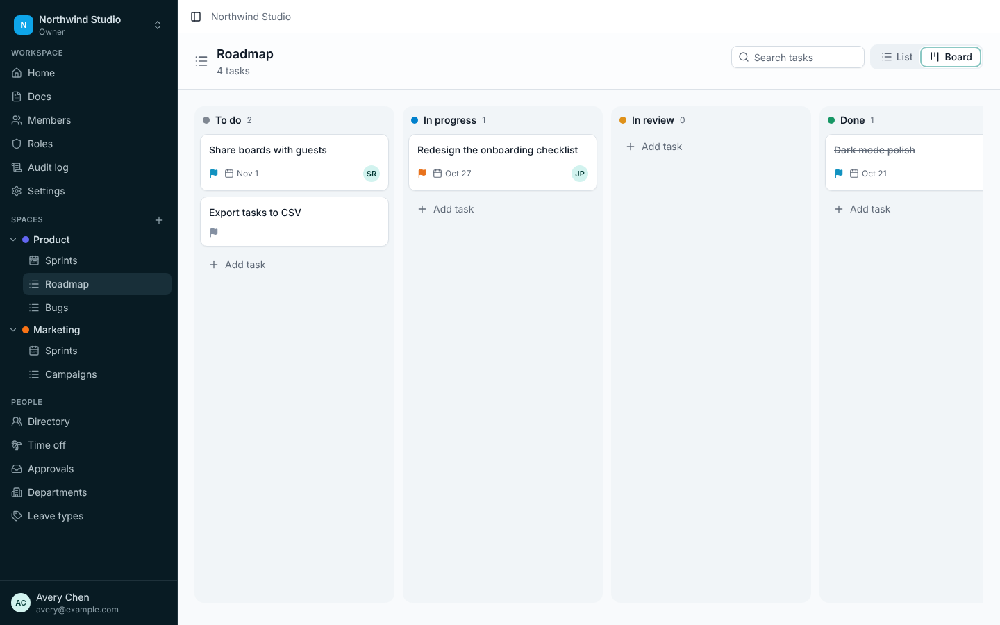
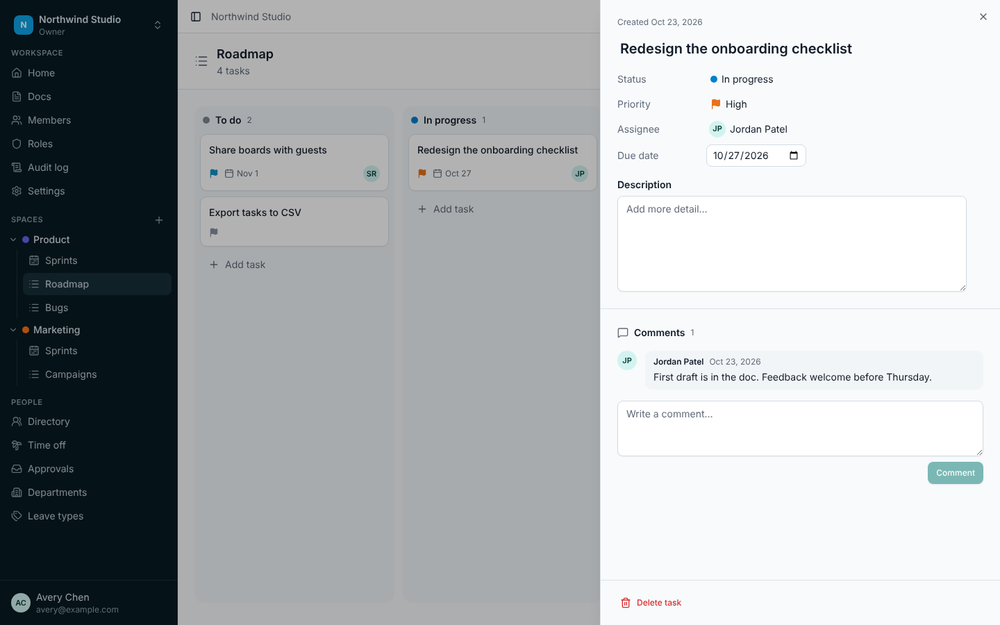
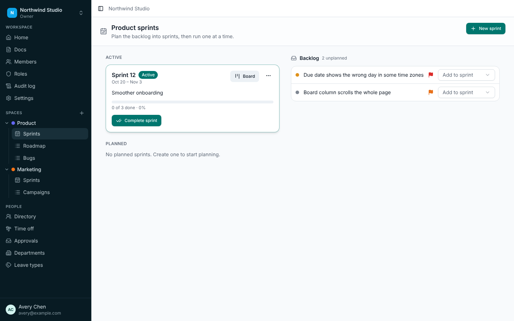
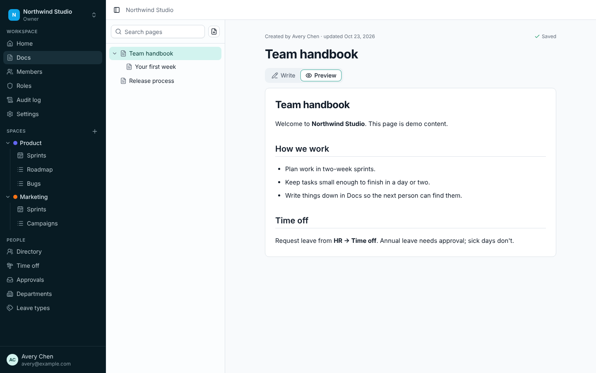
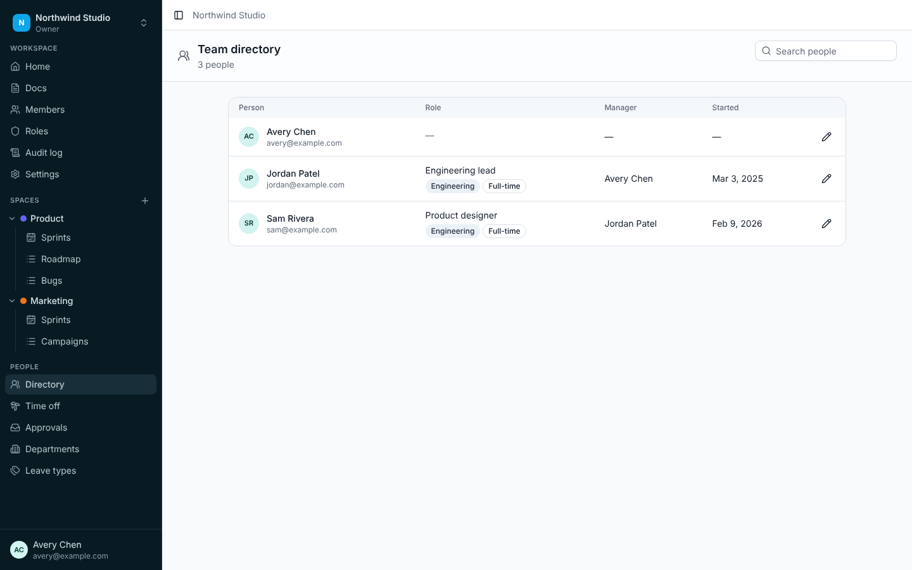
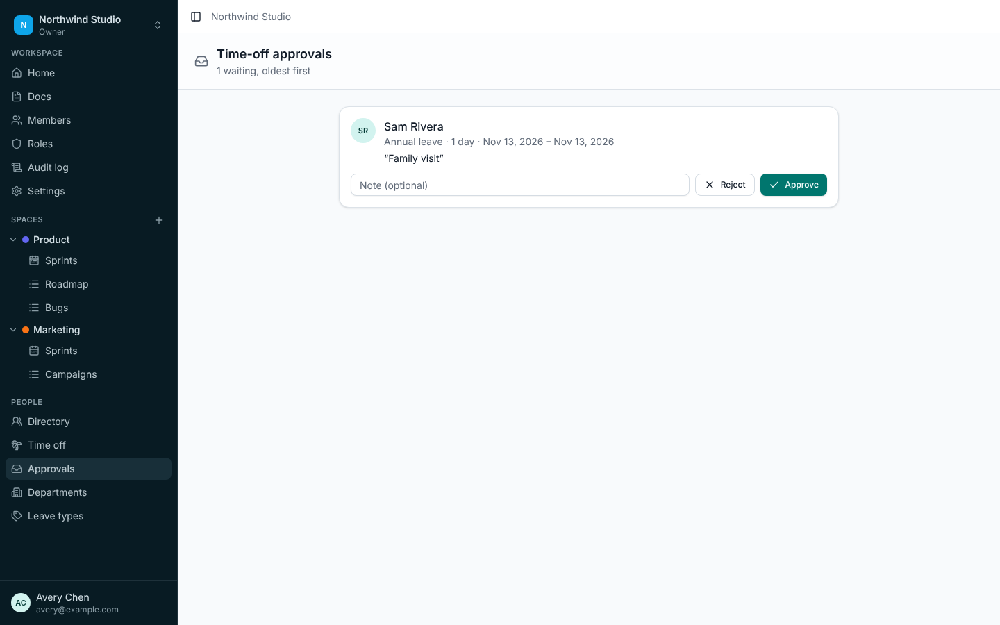
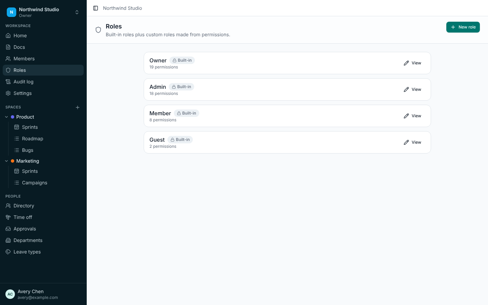
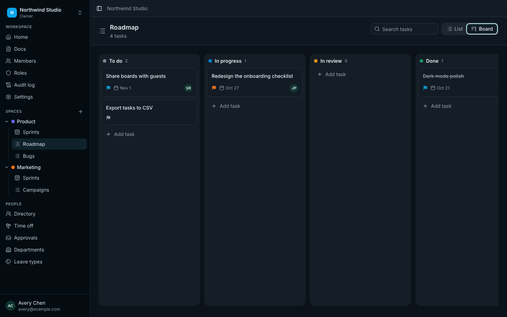

# TaskFlow

TaskFlow is a work-management app: tasks and boards, sprints, docs, and HR (people directory and time off) in one workspace, with built-in and custom roles, live updates, an inbox and a platform admin console. It's built in our own visual style; see [the plan](docs/plan/TASKFLOW_PLAN.md) for scope.

| Part | Stack |
|------|-------|
| API | NestJS 12, GraphQL (Apollo, code-first), TypeORM, Postgres 16 with row-level security, Better Auth |
| Web | React 19, Vite, TanStack Router and Query, Zustand, Tailwind and shadcn/ui |
| Shared | `@taskflow/shared-types` (domain constants and contracts), `@taskflow/sdk` (typed GraphQL operations generated from the schema) |
| Infra | Docker Compose and Terraform (Docker provider) for the local stack, GitHub Actions CI |

## Screenshots

Captured from the demo workspace (`pnpm --filter @taskflow/api seed`). All of them are in [docs/screenshots](docs/screenshots).

| | |
|---|---|
|  |  |
|  |  |
|  |  |
|  |  |

## Repository layout

```
apps/api        NestJS API: one module per feature, four layers each (see docs/architecture)
apps/web        React app: one module per feature, mirrors the API
packages/sdk    schema.graphql, operations/*.graphql and the generated typed client
packages/shared-types   permission keys, domain constants, request/response contracts
infra/docker    docker-compose.yml and the Postgres role script
infra/terraform the same stack with the Docker provider
docs/           plan, architecture (folder structure and rules), research log
```

The file-by-file layout and the SOLID and import-boundary rules are in [docs/architecture/FOLDER_STRUCTURE.md](docs/architecture/FOLDER_STRUCTURE.md). ESLint enforces the boundaries.

## Run the whole stack in Docker

Needs Docker with Compose.

```sh
cp .env.example .env
# Fill in POSTGRES_PASSWORD, APP_DB_OWNER_PASSWORD, APP_DB_PASSWORD and BETTER_AUTH_SECRET
# (e.g. `openssl rand -base64 48` for each). Never commit .env.
pnpm infra:up      # builds the images, runs migrations, starts Postgres, the API and the web app
```

Open http://localhost:8080. Production builds require a CAPTCHA and outgoing mail, so the stack uses safe local defaults:

- **CAPTCHA:** Cloudflare's public Turnstile test keys, which always pass. Set `TURNSTILE_SECRET_KEY` and `VITE_TURNSTILE_SITE_KEY` to real keys for a real deployment.
- **Mail:** a Mailpit container. Password reset emails land in its inbox at http://localhost:8025, and nothing leaves the machine. Set `SMTP_URL` and `MAIL_FROM` to a real provider for a real deployment.

`pnpm infra:down` stops everything.

The same stack is described in Terraform under `infra/terraform`: copy `terraform.tfvars.example` to `terraform.tfvars`, fill it in, then `terraform init && terraform apply`.

## Develop locally

Needs Node 22 (`.nvmrc`), pnpm 10 (`corepack enable`) and Docker for Postgres.

```sh
pnpm install
cp .env.example .env          # fill in the values; see the comments in the file
pnpm db:up                    # only Postgres, on 127.0.0.1:5432, with the two roles below
pnpm --filter @taskflow/api migration:run
SEED_PASSWORD='choose-a-password' pnpm --filter @taskflow/api seed   # optional demo workspace
pnpm dev:api                  # http://localhost:3000
pnpm dev:web                  # http://localhost:5173 (proxies /api to the API)
```

`DATABASE_URL` uses the runtime role (`APP_DB_USER`/`APP_DB_PASSWORD`) and `MIGRATION_DATABASE_URL` the schema owner (`APP_DB_OWNER`/`APP_DB_OWNER_PASSWORD`). The API's dev and CLI scripts read the repo's `.env`.

The seed creates "Northwind Studio" with three accounts (avery@, jordan@ and sam@example.com) that sign in with `SEED_PASSWORD`. It refuses to run when `NODE_ENV=production`.

## The API

Everything is GraphQL at `POST /api/graphql`. The only other routes are Better Auth's own handler at `/api/auth/*` (sign-up, sign-in, sessions, password reset) and the `GET /api/health` liveness probe for Docker. Outside production, introspection is on, so any GraphQL client can browse the schema; the schema is also committed at `packages/sdk/schema.graphql`.

Every workspace-scoped operation takes a `workspaceId` argument. A guard checks membership and permissions before the resolver runs, and callers outside the workspace get `NOT_FOUND`.

### Live updates and the inbox

The same path also takes GraphQL subscriptions over WebSocket (`graphql-ws`). `subscription workspaceEvents(workspaceId)` streams what changes in a workspace (`task.updated`, `comment.created`, `notification.created` and so on). Events carry ids only: the web app refreshes the affected queries, so every read still goes through the normal permission checks. Notification events only reach their recipient.

Services publish domain events inside their transaction, and `pg_notify` sends them on commit, so nothing is announced for a change that rolled back, and every API instance receives every event. The inbox (`query notifications`, `mutation markNotificationsRead`) is filled from the same events: assignments, comments on your tasks, time-off requests and decisions, and being added to a workspace. You never get notified about your own actions.

Sockets check the `Origin` header against `CORS_ORIGINS` and the session cookie before the connection is accepted. Subscribing needs workspace membership, and the server rechecks the session and membership every 30 seconds and ends the stream when either is gone. Reverse proxies need to pass the WebSocket upgrade for `/api/graphql` (the bundled nginx config and the Vite dev proxy do).

### Validation: one set of rules

Input rules live only on the API's input classes (class-validator), and `@FormSchema('task.create')` publishes them. The public `formSchemas` query returns every form's fields and rules (required, lengths, ranges, patterns, enums, dates, and cross-field rules such as "end on or after start"), each with the message the API itself uses. The web app has no validation library of its own: `useServerForm('task.create')` checks input in the browser with those rules, and when the API rejects a submit anyway, its per-field messages (`extensions.fields`) land next to the same inputs. The sign-in, sign-up and password forms work the same way; Better Auth checks them in a `before` hook.

### Filters, sorting and paging

Every list that grows (tasks, members, the audit log) is a *query resource*: a class in the feature's `infrastructure/` folder that declares which fields exist and how each can be filtered and sorted.

```ts
@QueryResource({ name: 'tasks', label: 'Tasks', permission: 'task.view', idColumn: 'task.id', defaultSort: [{ field: 'position', direction: 'asc' }] })
export class TaskQueryResource {
  @QueryField({ type: 'enum', column: 'task.status', options: TASK_STATUSES, sortable: true })
  status: string;

  @QueryField({ type: 'json', column: 'task.metadata' })   // filter as metadata.<key>
  metadata: string;
}
```

Clients send filters as a tree (`and`, `or`, `not`, conditions with `eq`, `neq`, `lt`…`gte`, `between`, `in`, `nin`, `contains`, `starts_with`, `ends_with`, `is_null`, `is_not_null`) or as a compact query string:

```graphql
searchTasks(workspaceId: $w, query: { where: "status[in]=todo,in_progress&metadata[order_id]=6735&assigneeId=@me", sort: [{ field: "dueDate", direction: desc }], pageSize: 50 })
```

The API checks every field, operator and value against the resource, enforces limits (depth 4, 30 conditions, 100 values per list, page size per resource) and compiles the rest to SQL with bound parameters only. `resourceSchema(workspaceId, resource)` describes each resource (fields, types, operators, enum options, sortable fields, page sizes, which of and/or/not are allowed), trimmed to the fields the caller may see, so the web app builds its tables and filter UI from it instead of hard-coding them.

### Caching

Reads are cached in Redis (`REDIS_URL`, required in production; without it each instance caches in memory). Service methods opt in with a decorator:

```ts
@Cached({ entities: ['space'], shared: true })   // shared: same answer for every member
async list(workspaceId: string): Promise<SpaceResponse[]> { ... }
```

Keys are scoped to the workspace (and to the user unless `shared`), mutations never read the cache, and every domain event drops the tags it affects, first in the transaction and again on every instance after commit. Membership checks are cached for 60 seconds at most. Writes use `@Audited(...)` and `@Announces(...)` instead of hand-written audit and event code.

### Typed client (SDK)

The web app never writes queries inline. Operations live in `packages/sdk/operations/*.graphql`, and codegen turns them into typed documents:

```ts
import { TasksDocument } from '@taskflow/sdk';
const { tasks } = await graphql(TasksDocument, { workspaceId, listId, pageSize: 50 }); // fully typed
```

After changing a resolver or an operation, run `pnpm sdk:generate`. It exports the schema from the API, validates every operation against it, regenerates the types, and rebuilds the SDK. Commit the result; CI fails if the generated files are stale.

## Tests and checks

```sh
pnpm lint          # ESLint, including the architecture boundary rules
pnpm typecheck
pnpm test          # unit tests (API and web)
pnpm build
```

End-to-end tests run the built API against a real Postgres. The API suite calls GraphQL over HTTP and also checks row-level security directly in the database. The web suite drives Chromium with Playwright. They need a dedicated database whose name contains "test":

```sh
pnpm db:up
sh scripts/create-e2e-database.sh   # creates taskflow_test with its own roles, writes .env.e2e
pnpm build
pnpm test:e2e
```

CI (`.github/workflows/ci.yml`) runs all of the above, plus `pnpm audit`, a check that the generated SDK is current, and Terraform and Compose validation. Every action is pinned to a commit SHA.

## Security

[AGENTS.md](AGENTS.md) lists the rules every change must keep. The main mechanisms:

- **Tenant isolation in the database.** Postgres row-level security is forced on every tenant table. The API runs each GraphQL operation in a transaction scoped to one workspace, so a query that forgets its `workspace_id` filter still can't read or write another tenant's rows. The API connects as a role that owns nothing and can't bypass RLS, and it refuses to start in production otherwise.
- **Policies (IAM).** Roles get their rights from policies: ready-made *managed* policies (Full access, Workspace admin, Contributor, Read only, Sprint planner, People manager, Auditor, Hide member emails), the workspace's own *custom* policies, and an *inline* policy per role. Statements allow or deny permissions (`task.*`) and fields (`member.email`), and deny always wins. Nobody can attach, edit or remove a policy if the role would end up with more than they have themselves, and the Owner role can't be changed.
- **Field-level access.** Fields marked `@SensitiveField('member.email', ...)` resolve to null for callers whose policies don't allow them; member emails are hidden by default and visible to owners, admins and People managers. The same rules keep those fields out of filters, sorting, search and `resourceSchema`.
- **Access checks on the server.** A session guard runs on every operation. A workspace guard checks membership and the permission keys of the member's role. Custom roles can't grant permissions their creator doesn't have. Super admins are audited when they write inside someone else's workspace.
- **GraphQL limits.** Query depth, cost (which stops alias amplification) and token limits; page sizes capped at 100; no batching; CSRF prevention; introspection and "did you mean" hints off in production; generic error messages.
- **Input.** Every argument is validated on the server, and unknown fields are rejected. Markdown is sanitised on the server and rendered without raw HTML.
- **Auth.** Better Auth with secure cookies and rate limits on sign-up, sign-in and password reset. Reset links are single use, expire after 30 minutes and sign out every other session. New accounts get a confirmation email, and workspace invites only reach confirmed addresses, so nobody can sign up with a colleague's email and inherit their access. Turnstile CAPTCHA on public forms, required in production.
- **Audit.** Admin, role and HR actions go to an append-only audit log (a trigger blocks changes).

Operator tasks: `pnpm --filter @taskflow/api admin:promote <email>` makes an existing account a super admin. It needs database access, so it can't be triggered from the web.
